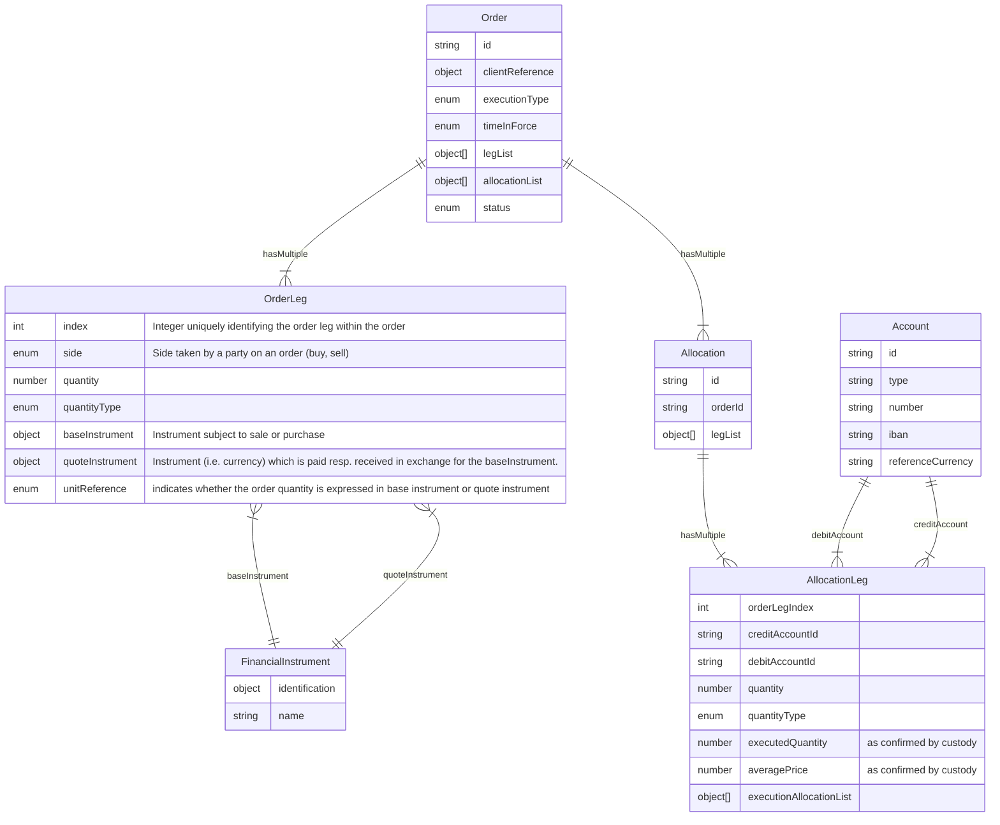
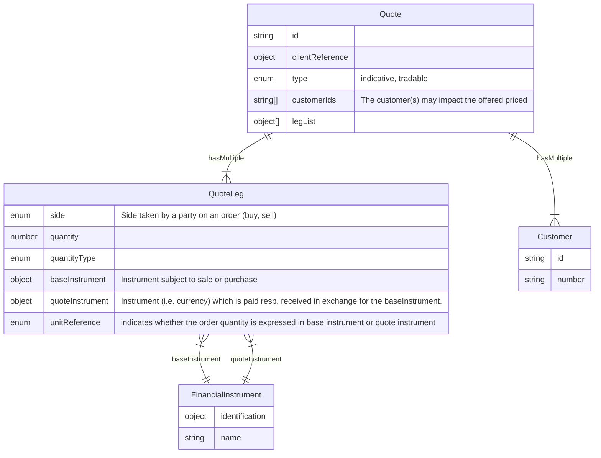
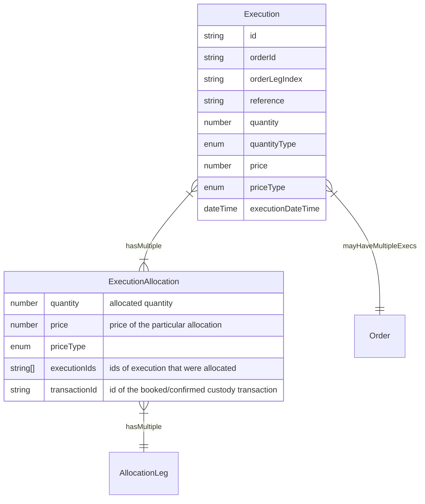

In the following we will describe the essential data objects, their relations and their interface representation. We will highlight conventions an try to enhance a common understanding of these objects.

- [Customer](#customer)
- [Account](#account)
- [Financial Instrument](#financial-Instrument)
- [Order, Allocation and Legs](#order-allocation-and-legs)
- [Quote](#quote-and-legs)

## Customer

The customer entity describes the business (contractual) partner of the custodian bank. This can be a natural person, a legal person or a person association. In the case of legal persons the customer is usually the account holder and beneficial owner of the associated accounts. The customer must be uniquely identified with an id used in the api.

## Account

An account is an entity that describes a basket/container of financial instruments. Each account must be associated to a customer (typically the account holder and beneficial owner) and is usually enclosed in a portfolio. There mainly two types of accounts:

- Cash Account
- Safekeeping Account

An account must by identified by a unique reference, the account number. Most cash accounts (and some safekeeping accounts) should also have an [IBAN](https://en.wikipedia.org/wiki/International_Bank_Account_Number) - International Bank Account Number - associated to it.

The cash account is as commonly understood a container for holdings of a currency. In this case the currency can be looked at as the financial instrument identified by its ISO3 currency code. In the case of a cash account the ladder holds only one financial instrument.
The safekeeping account is commonly used es a container for exchange traded instruments. The financial instrument is typically identified by an [ISIN](https://en.wikipedia.org/wiki/International_Securities_Identification_Number) - International Securities Identification Number. However there are many more instrument types that need to be considered, such as OTC products, like FX Forwards, currency & interest swaps, cryptocurrencies etc.

## Financial Instrument

A financial instrument is an entity that describes a monetary contract, which confers a right or claim against some counterparty in the form of a payment, equity ownership or dividends (stocks), debt (bonds, loans, deposit accounts), currency (forex), or derivatives (futures, forwards, options, and swaps). Financial instruments can be segmented by asset class, and as cash-based, securities, or derivatives.
An exchange traded financial instrument is typically identified by an [ISIN](https://en.wikipedia.org/wiki/International_Securities_Identification_Number) - International Securities Identification Number. Many other instrument types such as OTC products, like FX Forwards, currency & interest swaps, cryptocurrencies etc. have proprietary ways of identification.
In the context of OpenWealth the identification of the financial instrument is mandatory. In addition all properties (such as contract size, price factor, denomination, derivative figures etc.) required for a correct valuation of the instrument should be added to the properties. There are many classification schemes available for the classification of an instrument. OpenWealth proposes to use ISO 10962 as the standard classification of an instrument.

Note that from the version 3 of the API the tradable instrument universe has been extended to also support foreign exchange, fx forwards & swaps, ETDs (exchange traded derivatives), digital assets (crypto currencies) and to some extent trading strategies (such as algo trades and structured products). Therefore additional properties have been introduced to fully specify and identify these instruments.

## Order, Allocation and Legs

**Order**

An order in financial trading is simply an instruction from an investor to a broker or exchange to buy or sell a financial instrument under specified conditions. Since OpenWealth supports multileg orders since the version 3 the order entity mainly consists of general properties as execution type, type in force and identification, whereas the order leg entity defines base and quote instruments, quantity and pricing information. Note that the structure has been generalized to support multileg orders as well as a larger instrument universe (i.e. derivatives, digital assets and fx). A single instrument order would consist of just one leg where the base instrument denotes the instrument that is subject of sale or purchase and the quote instrument would denote the currency received or paid.
Note that the minimal required properties for a leg are the side the ordering party takes, base & quote instrument, the quantity and the unit reference - the instrument the quantity refers to - and the index, where the index uniquely defines the leg in the order. The index is used to ensure that allocation legs (see below) can uniquely be associated with an order leg

**Allocation**

TBD

**Entity Relationships of an order with allocation and legs**

## Quote And Legs

TBD

**Entity Relationships of a quote**

## Execution

TBD

**Entity Relationships of an execution**

