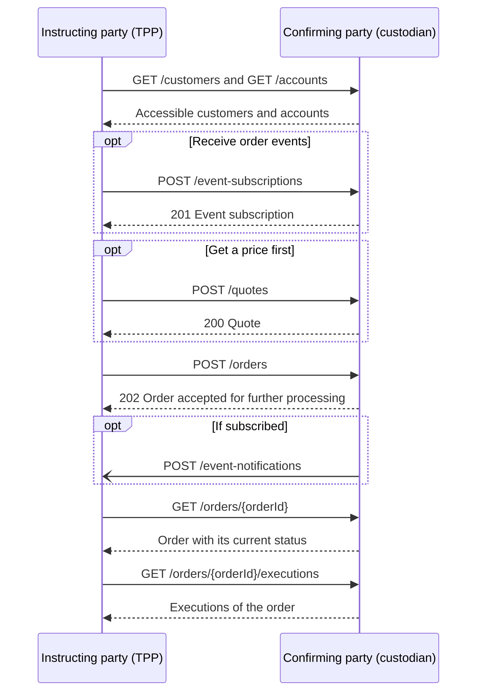

# OpenWealth Trading API

This API is part of the OpenWealth APIs for the connectivity between custody banks and WealthTechs (e.g. Portfolio Management Systems). The Trading API (previously Order Placement API) gives wealth managers and their technology providers one standard way to place orders with a custodian bank and follow them through to execution. A provider can reuse the same integration across the custodians offering the API, rather than building a different one for each bank.

- [Overview and scope](#overview-and-scope)
- [How an order is structured](#how-an-order-is-structured)
- [The typical flow](#the-typical-flow)
- [Polling or events](#polling-or-events)
- [Before you start](#before-you-start)
- [Entities and operations of the API](#entities-and-operations-of-the-api)
- [Documentation](#documentation)
- [Folder structure](#folder-structure)

# Overview and scope

The API connects two parties:

- The **instructing party** sends the order. This is usually a third party provider (TPP), such as a portfolio management system or robo-advisor, acting for a wealth manager.
- The **confirming party** receives and confirms the order and reports its status and executions. This is usually the custodian bank.

The instructing party assigns its own `clientReference` to each order. The confirming party assigns the order `id`, which is then used in all follow-up requests.

Since version 3 the API supports multi-leg orders and a wider instrument universe, including foreign exchange, FX forwards and swaps, exchange traded derivatives and digital assets.

The repository also contains example payloads for equity, bond, crypto, FX spot and FX swap flows.

# How an order is structured

An order separates what is traded from where it is booked:

- The **order** holds the general instructions, such as `executionType` (market, limit, stop or stopLimit) and `timeInForce`.
- Each **order leg** says what is traded: the `side`, the `quantity`, the `baseInstrument` being bought or sold and the `quoteInstrument` paid or received in exchange. The `side` always relates to the base instrument.
- Each **allocation** says which accounts the order is booked to. Its legs name the debit and credit account and the quantity for that allocation, and refer to an order leg through `orderLegIndex`.

The number of legs depends on what is traded. A single-instrument order has one leg. A swap has exactly two, with the near leg first and the far leg second. Other multi-leg orders have one leg per instrument involved.

Because an order can have several allocations, one order can serve many clients as a bulk order. Pre-trade checks can fail for some of those clients. By default the whole order is then rejected, but with `bestEffortExecution` set to `true` the failed allocations are removed and the rest of the order proceeds.

This example buys 10,000 shares against Swiss francs, with the cash taken from one account and the shares credited to another:

```json
{
  "clientReference": "123-123124",
  "executionType": "market",
  "timeInForce": "goodTillCancel",
  "legList": [
    {
      "index": 0,
      "side": "buy",
      "quantity": 10000,
      "quantityType": "unit",
      "baseInstrument": {
        "name": "CREDIT SUISSE GROUP AG",
        "identification": {
          "identifier": "CH0012138530",
          "type": "isin"
        }
      },
      "quoteInstrument": {
        "name": "Swiss franc",
        "identification": {
          "identifier": "CHF",
          "type": "iso4217"
        }
      },
      "unitReference": "baseInstrument"
    }
  ],
  "allocationList": [
    {
      "legList": [
        {
          "orderLegIndex": 0,
          "debitAccountId": "cash-account-chf-1",
          "creditAccountId": "safekeeping-account-1",
          "quantity": 10000,
          "quantityType": "unit"
        }
      ]
    }
  ]
}
```

More examples, including bonds, crypto, FX spot and FX swaps, are in the [examples folder](components/examples/orders).

# The typical flow



## 1. Find customers and accounts

`GET /customers` and `GET /accounts` return what the requesting user has access to. The `accessType` of an account shows whether that access is `read` or `write`. The account ids are then used in the allocations of an order.

## 2. Request a quote (optional)

`POST /quotes` returns a price for the requested legs. An `indicative` quote informs about the market and does not lead directly to a trade. A `tradable` quote is a price to trade on: pass its id as `quoteId` when placing the order. Each quote can state when it expires in `expiryDateTime`.

## 3. Place the order

`POST /orders` answers with `202`, which means the order was accepted for further processing, not that it was executed. The outcome arrives later through the order status.

`POST /orders/{orderId}/actions/cancel` requests the cancellation of an order. It also answers with `202`, so the cancellation is only confirmed by the later status of the order. A completely filled order can no longer be cancelled.

## 4. Follow the order

Every order has a `status`, and `GET /orders/{orderId}/states` returns its history with a timestamp for each status. An order that runs without problems moves through these statuses:

`acknowledged` → `accepted` → `placed` → `filled` → `executed`

`filled` means the market has executed the whole order. `executed` is the final status, reached once the fills have been allocated to the clients. All statuses and the transitions between them are described in the [entity model](Docs/EntityModel.md#order-status).

`GET /orders` returns open orders only, so use `GET /orders/{orderId}` to read an order after it has closed.

## 5. Read the results

Results are available at two levels:

- An **execution** is a single trade in the market for one order leg, returned by `GET /orders/{orderId}/executions`.
- An **execution allocation** is the part of those executions assigned to an allocation leg, with its price, billing details and booking information. Use `expand_order=allocationList.executionAllocationList` to include these when querying an order.

# Polling or events

You can follow orders by polling, or subscribe to events to reduce the number of requests. A subscription names the event types of interest (`heartbeat`, `order:doneForDay` or `order:statusUpdated`) and a `callbackUrl`.

Notifications are then pushed to the `POST /event-notifications` endpoint that the TPP provides, as specified in [webhookAPI.yaml](webhookAPI.yaml). They can also be retrieved with `GET /event-subscriptions/{eventSubscriptionId}/event-notifications`.

A notification carries a `resourceLink` to the affected order and not the order itself, so a typical consumer fetches the order after receiving one:

```json
{
  "id": "120066c9-58a1-432b-aa60-712fae7f143e",
  "version": "1.0",
  "eventType": "order:statusUpdated",
  "eventSubscriptionId": "7c5f40fc-1b29-4263-a2dd-e127a22a947f",
  "resourceLink": "/orders/order-equity-1",
  "creationDateTime": "2025-04-11T11:35:11Z"
}
```

# Before you start

- **Authentication:** the specification does not define a security scheme, so clarify the access method with the API provider.
- **Correlation:** every request must include a `Correlation-Id` header, which is returned in the response.
- **Paging:** list endpoints accept `cursor` and `limit` parameters. The cursor for the next page is returned in the `Next-Cursor` response header.
- **Instrument identification:** every instrument must be identified by an `identifier` and its `type`, such as `isin`, `iso4217` or `digitalAssetTicker`.
- **Other APIs:** the Trading API can be implemented independently of the Custody and Customer APIs.

# Entities and operations of the API

The API defines endpoints for the following business objects:

| Business object | Purpose | Endpoints |
| --- | --- | --- |
| **Customers** | Query business partners accessible to the requesting user | `GET /customers`, `GET /customers/{customerId}` |
| **Accounts** | Query cash and safekeeping accounts accessible to the requesting user | `GET /accounts`, `GET /accounts/{accountId}` |
| **Quotes** | Request an indicative or tradable price | `POST /quotes` |
| **Orders** | Place orders, query them and request their cancellation | `POST /orders`, `GET /orders`, `GET /orders/{orderId}`, `POST /orders/{orderId}/actions/cancel` |
| **Order states** | Query the status history of an order | `GET /orders/{orderId}/states` |
| **Executions** | Query the market executions of an order | `GET /orders/{orderId}/executions`, `GET /orders/{orderId}/executions/{executionId}` |
| **Event subscriptions** | Manage subscriptions to order events | `GET` and `POST /event-subscriptions`, `GET`, `PUT` and `DELETE /event-subscriptions/{eventSubscriptionId}` |
| **Event notifications** | Retrieve the notifications of a subscription | `GET /event-subscriptions/{eventSubscriptionId}/event-notifications` |

The TPP can also receive event notifications as webhooks. The endpoint it has to provide for this, `POST /event-notifications`, is specified separately in [webhookAPI.yaml](webhookAPI.yaml).

# Documentation

The [entity model](Docs/EntityModel.md) describes the business objects, how they relate to each other, the order statuses and the main enumerations.

A general introduction on how to use OpenAPI specifications can be found here:

[Getting started](https://github.com/OpenWealth/OpenWealth/wiki/getting-started)

Further documentation of the Trading API is found in the wiki:

[Trading API Documentation](https://github.com/OpenWealth/OpenWealth/wiki/trading-api)

# Folder structure

```md
trading
├── API.yaml          Root of the Trading API specification
├── webhookAPI.yaml   Webhook endpoint implemented by the TPP
├── Docs              Entity model
├── paths             One file per API path
├── components
│   ├── parameters
│   ├── schemas
│   ├── examples      Example payloads, by business object
```

These are the source files. The bundled release files are [tradingAPI.yaml](../../tradingAPI.yaml) and [tradingWebhookAPI.yaml](../../tradingWebhookAPI.yaml) in the repository root, and they may get out of sync with this folder until the next release.
